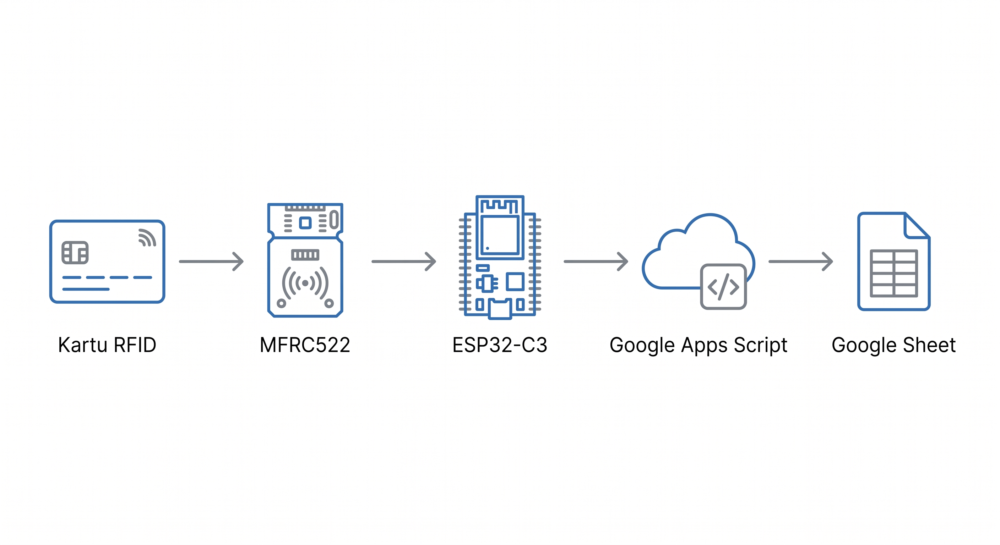

# Sistem Logbook Pengunjung Lab berbasis RFID

Rancangan sistem pencatatan kunjungan lab, dari surat izin sampai pengunjung tinggal tap
kartu RFID di pintu masuk.

## Latar Belakang

Pencatatan pengunjung lab saat ini masih manual, memakai Google Form untuk mencatat siapa
yang masuk, kapan, dan untuk keperluan apa. Sistem ini mengotomatiskan bagian
pencatatan kehadiran saja — pengunjung yang sudah terdaftar tinggal tap kartu RFID di
pintu masuk. Proses administratif seperti surat izin tetap berjalan manual seperti biasa.

## Cara Kerja

```
1. Pengunjung mengajukan surat izin kunjungan ke lab/kampus (di luar sistem ini).
2. Admin lab menyetujui surat izin.
3. Admin mendaftarkan pengunjung ke Google Sheet: nama, institusi, tujuan, dan UID
   kartu RFID.
4. Pengunjung tap kartu RFID di reader saat masuk lab.
5. Reader mencocokkan UID ke data terdaftar dan mencatat waktu tap sebagai log kunjungan.
```

Langkah 1–3 adalah pendaftaran, dilakukan sekali per pengunjung. Langkah 4–5 berulang
setiap kali pengunjung datang. Satu tap mencatat satu kunjungan — tidak ada tap keluar,
jadi sistem ini mencatat kehadiran saja, tanpa menghitung durasi kunjungan.

## Arsitektur



- **MFRC522** membaca UID kartu lewat SPI.
- **ESP32-C3 SuperMini** membaca UID dari MFRC522, terhubung ke WiFi UGM-IoT (WPA2-PSK),
  dan mengirim UID ke Apps Script lewat HTTPS setiap ada tap.
- **OLED SSD1306 128x64** terhubung ke ESP32 lewat I2C, menampilkan hasil tap kepada
  pengunjung di pintu masuk. Perangkat tetap mencatat tap ke Sheet walaupun layarnya gagal
  diinisialisasi.
- **LED hijau dan merah** menandai hasil tap: hijau untuk tap yang tercatat, merah untuk kartu
  yang belum terdaftar atau kegagalan jaringan.
- **Google Apps Script** menerima UID, mencocokkannya ke Sheet `Pengunjung`, mencatat ke
  Sheet `Log_Kunjungan` kalau valid, dan membalas status ke ESP32.
- **Google Sheet** menyimpan dua tab: `Pengunjung` untuk data hasil pendaftaran, dan
  `Log_Kunjungan` untuk riwayat tap. Admin melihat dan mengedit data langsung lewat Sheet,
  tanpa halaman admin terpisah.

Sistem awalnya memakai server sendiri (Flask + SQLite) yang jalan di komputer lab. Server
itu diganti Google Sheets dan Apps Script karena dua alasan: komputer lab pakai Ethernet
sedangkan device pakai WiFi, jadi keduanya sulit disatukan dalam satu jaringan; dan Apps
Script Web App punya URL tetap yang bisa diakses dari jaringan mana pun asal ada internet,
tanpa perlu komputer yang menyala terus-menerus.

## Pinout

**MFRC522 — SPI**

| MFRC522 | ESP32-C3 |
|---|---|
| VCC | 3.3V |
| GND | GND |
| SCK | GPIO4 |
| MISO | GPIO5 |
| MOSI | GPIO6 |
| SDA (CS) | GPIO7 |
| RST | GPIO10 |
| IRQ | tidak disambung |

**OLED SSD1306 — I2C, alamat `0x3C`**

| OLED | ESP32-C3 |
|---|---|
| VCC | 3.3V |
| GND | GND |
| SDA | GPIO0 |
| SCL | GPIO1 |

**LED status**

| LED | ESP32-C3 |
|---|---|
| Hijau, melalui resistor 220 Ω | GPIO21 |
| Merah, melalui resistor 220 Ω | GPIO20 |

GPIO8 dan GPIO9 tidak digunakan walaupun keduanya pin I2C default ESP32-C3. Pada board
SuperMini, GPIO8 tersambung ke LED onboard dan GPIO9 ke tombol BOOT, dan keduanya pin
strapping yang ikut menentukan mode boot chip. GPIO0 dan GPIO1 bebas dari fungsi tersebut,
sehingga lebih aman untuk perangkat yang dipasang permanen.

GPIO20 dan GPIO21 adalah pin UART0, yang bebas dipakai karena Serial berjalan melalui USB CDC.

Semua modul mengambil daya dari jalur 3.3V SuperMini melalui PCB. Nilai pin di atas
didefinisikan di bagian atas [logbook-firmware/src/main.cpp](../logbook-firmware/src/main.cpp).

## PCB dan Casing

PCB satu sisi 46×48 mm menampung socket SuperMini, header ke RC522, pad solder kabel untuk OLED
dan kedua LED, serta dua resistor LED. Berkas KiCad, Gerber untuk pabrikasi maupun milling CNC,
dan PDF untuk toner transfer ada di [PCB/](../PCB/).

Casing cetak 3D berbentuk kucing yang memikul kotak elektronik dengan muka miring 20° dari meja.
RC522, OLED, dan LED menempel di balik tutup, sedangkan PCB duduk di lantai kotak. Berkas STL
ada di [Casing/kucing-kotak-menyatu/](../Casing/kucing-kotak-menyatu/). Rincian rancangan
keduanya ada di [Tutorial/Hari-6-LED-PCB-Casing](../Tutorial/Hari-6-LED-PCB-Casing.md).

## Skema Data

**Tab `Pengunjung`** — satu baris per pengunjung terdaftar.

| Kolom | Keterangan |
|---|---|
| `uid_kartu` | UID kartu RFID pengunjung |
| `nama` | Nama pengunjung |
| `institusi` | Asal institusi/kampus/perusahaan |
| `tujuan` | Keperluan kunjungan |
| `tanggal_daftar` | Tanggal pendaftaran |
| `status` | `aktif` atau `nonaktif` |

**Tab `Log_Kunjungan`** — satu baris per tap kartu.

| Kolom | Keterangan |
|---|---|
| `uid_kartu` | Merujuk ke `Pengunjung.uid_kartu` |
| `nama` | Disalin dari `Pengunjung` saat tap terjadi |
| `tujuan` | Disalin dari `Pengunjung` saat tap terjadi |
| `waktu_tap` | Waktu tap |

Nama dan tujuan disalin ke `Log_Kunjungan` (bukan sekadar dirujuk lewat UID) supaya riwayat
langsung terbaca tanpa perlu membuka tab lain, dan tetap merekam kondisi pengunjung saat
tap terjadi meskipun datanya di `Pengunjung` diedit belakangan.

## Pemilihan Mikrokontroler

WiFi lab tersedia dalam dua bentuk: eduroam (WPA2-Enterprise) dan captive portal. Keduanya
tidak didukung modul WiFi murah seperti ESP-01, jadi rancangan awal (STM32 + ESP-01
terpisah) diganti satu chip WiFi-mikon yang bisa menjalankan autentikasi sendiri. Proses
mencari chip yang benar-benar berhasil connect ke eduroam butuh empat percobaan board:

| Board | Hasil |
|---|---|
| Wemos D1 Mini (ESP8266) | Build berhasil, tapi gagal konsisten connect eduroam meski kredensial terbukti benar (berhasil di Windows). SDK WPA2-Enterprise ESP8266 hanya mendukung TLS 1.0 — kemungkinan sudah dinonaktifkan di RADIUS server eduroam kampus. |
| ESP32-C3 SuperMini | Dukungan WPA2-Enterprise lebih matang (PEAP-MSCHAPv2 didukung), tapi board brownout berulang saat WiFi transmit — regulator daya bawaan tidak cukup kuat untuk lonjakan arus hingga 500mA. |
| ESP32 WROOM | Regulator lebih baik, brownout hilang. Eduroam tetap gagal, dengan kode alasan yang berbeda-beda tiap percobaan (`BEACON_TIMEOUT`, `ASSOC_FAIL`, `HANDSHAKE_TIMEOUT`, `AUTH_EXPIRE`), termasuk ke access point fisik yang berbeda. Laporan serupa ada di [issue #5027 arduino-esp32](https://github.com/espressif/arduino-esp32/issues/5027): berhasil lewat ESP-IDF murni, gagal lewat Arduino core. |
| ESP32-C3 SuperMini (dipakai kembali) | Eduroam ditinggalkan, WiFi pindah ke WPA2-PSK (UGM-IoT) yang tidak punya masalah stabilitas serupa di board manapun. Brownout sebelumnya murni soal power supply saat pengujian, bukan cacat chip — dipakai lagi dengan power supply yang memadai. |

Mikon final: **ESP32-C3 SuperMini**, WiFi WPA2-PSK ke UGM-IoT.

## Status dan Rencana Kerja

Sistem tap-in sudah berjalan penuh dari kartu fisik sampai tercatat di Sheet.

| Hari | Pekerjaan | Status |
|---|---|---|
| 1 | Google Sheet + Apps Script (endpoint `doPost`, deploy Web App) | Selesai — [detail](../Tutorial/Hari-1-Setup-Sheet-AppsScript.md) |
| 2 | Form pendaftaran pengunjung | Dilewati — admin mendaftarkan pengunjung langsung ke Sheet |
| 3 | ESP32 connect WiFi + HTTPS ke Apps Script | Selesai — [detail](../Tutorial/Hari-3-WiFi-HTTPS-AppsScript.md) |
| 4 | Integrasi pembaca RFID | Selesai — [detail](../Tutorial/Hari-4-Integrasi-RFID.md) |
| 5 | Umpan balik OLED untuk pengunjung | Selesai — [detail](../Tutorial/Hari-5-Umpan-Balik-OLED.md) |
| 6 | LED status, PCB, casing, dan layar beranimasi | Selesai — [detail](../Tutorial/Hari-6-LED-PCB-Casing.md) |

Beberapa kendala teknis ditemukan dan diperbaiki sepanjang Hari 3 sampai 6: Serial Monitor
yang tidak menampilkan output, bug redirect di HTTPClient, duplikat request dari infrastruktur
Google, USB yang perlu dicabut-pasang ulang setelah upload, penyambungan ulang WiFi yang
berulang, rantai redirect yang tidak pernah diikuti sampai habis, deployment Web App yang mati
setelah Sheet dipindah, dan urutan pin daya OLED yang berbeda dari rancangan PCB pertama. Detail
tiap kendala beserta perbaikannya ada di Tutorial masing-masing hari.

## Riwayat Rilis

| Versi | Isi |
|---|---|
| v1.0 | Tap-in RFID sampai tercatat di Google Sheet |
| v1.1 | Umpan balik status di layar OLED |
| v2.0 | Alat mandiri di pintu masuk: animasi bongo cat, diagnosis kegagalan jaringan di layar, perbaikan dua bug jaringan |

Perubahan setelah v2.0 belum masuk rilis bertanda: LED status, PCB, casing, dan layar hasil tap
beranimasi. Semuanya terurai di [Tutorial/Hari-6-LED-PCB-Casing](../Tutorial/Hari-6-LED-PCB-Casing.md).

## Yang Masih Terbuka

- **Jaringan untuk pemasangan permanen.** Sistem memerlukan resolusi DNS dan akses HTTPS ke
  `script.google.com` beserta `script.googleusercontent.com`. Domain kedua mudah terlewat
  saat mengajukan izin akses, padahal balasan Apps Script diambil dari sana — tanpa akses ke
  situ, tap tetap tercatat di Sheet tapi perangkat tidak pernah menerima konfirmasinya. Salah
  satu jaringan yang dicoba memblokir kueri DNS ke luar, dan perangkat mengenalinya sendiri
  sebagai `DNS block`.
- **Uji koneksi WiFi yang putus di tengah pengiriman.** Kartu tidak terdaftar sudah diuji di
  Hari 4 dan berperilaku benar.
- **OLED padam ketika alat tersenggol.** Sambungan daya OLED yang terputus sesaat membuat
  SSD1306 reset ke keadaan layar mati, sementara firmware hanya menginisialisasi OLED sekali saat
  boot. ESP32 tetap mencatat tap, tetapi layar baru menyala lagi setelah tombol RST ditekan.
  Perbaikan di sisi perangkat keras berupa solder ulang kabel J2 dan kapasitor 220–470 µF di kaki
  daya modul OLED. Di sisi firmware, inisialisasi ulang OLED setelah tiap tap dapat ditambahkan.
- **Balasan HTTP selain 302 tampil sebagai `No route`.** Firmware mencoba body balasan (mis. 404)
  sebagai URL redirect, sehingga layar menampilkan `No route code -1` alih-alih kode HTTP yang
  sebenarnya. Kasus ini muncul saat deployment Web App mati (lihat Hari 6, Kendala 1).
- **Penanganan tap yang gagal terkirim.** Saat ini kunjungan yang gagal dikirim hilang begitu
  saja. Mengantrekannya lalu mengirim ulang setelah jaringan pulih akan membuat sistem jauh
  lebih tahan terhadap gangguan sesaat.
