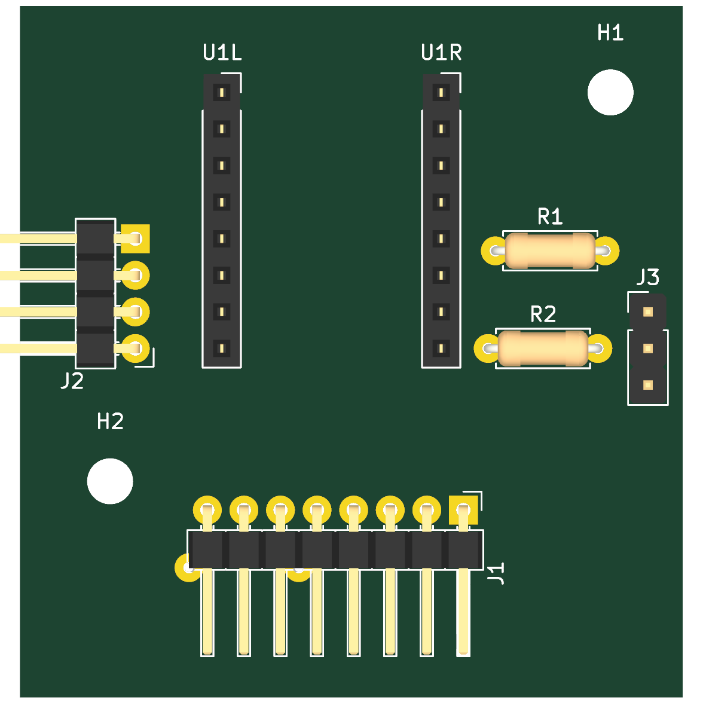
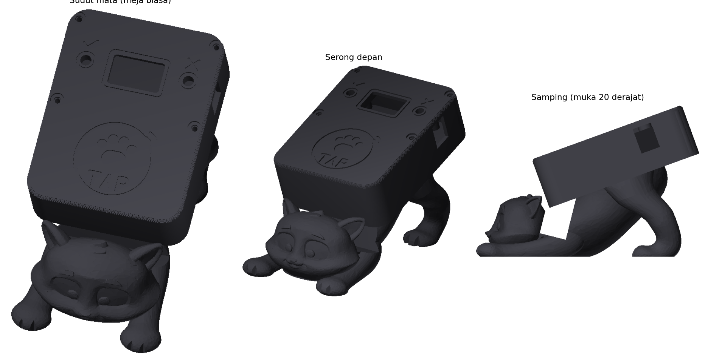
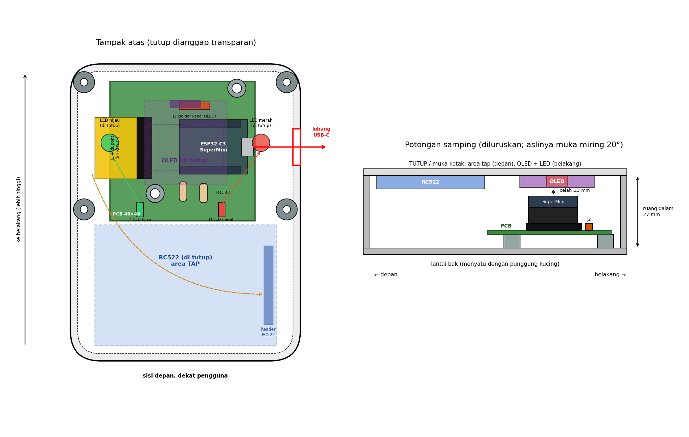

# Hari 6 — LED Status, PCB, Casing, dan Layar Beranimasi

Langkah kerja Hari 6 dari rencana kerja di [Sistem-Logbook-Pengunjung-RFID](../Dokumen/Sistem-Logbook-Pengunjung-RFID.md#status-dan-rencana-kerja). Prototipe breadboard dari Hari 5 dipindah ke PCB dan casing supaya dapat dipasang permanen di pintu masuk.

## Goals hari ini

- [x] Tambah LED hijau dan merah sebagai tanda hasil tap yang terlihat dari jauh.
- [x] Rancang PCB satu sisi yang dapat dibuat sendiri di lab (toner transfer atau milling CNC).
- [x] Cetak casing 3D yang menampung PCB, RC522, OLED, dan kedua LED.
- [x] Ganti layar hasil tap yang masih berupa teks dengan animasi.

## LED status

| LED | Pin | Resistor | Menyala saat |
|---|---|---|---|
| Hijau | GPIO21 | 220 Ω | Tap tercatat, tetap selama 7 detik |
| Merah | GPIO20 | 220 Ω | Kartu belum terdaftar (tetap) atau kegagalan jaringan (berkedip) |

GPIO20 dan GPIO21 adalah pin UART0, yang bebas dipakai karena Serial berjalan melalui USB CDC.
ROM bootloader tetap mengirim log boot ke GPIO21, sehingga LED hijau berkedip sesaat setiap kali
perangkat dinyalakan.

## Layar hasil tap

Ketiga layar berikut menggantikan tampilan teks dari Hari 5. Semuanya ditahan selama
`RESULT_HOLD_MS` (7 detik) sebelum kembali ke `Please tap`.

| Kondisi | Tampilan |
|---|---|
| Kartu terdaftar | Bongo cat menabuh di paruh atas, `Welcome,` lalu nama pengunjung diketik huruf per huruf |
| Kartu `SPECIAL_UID` | Kucing ksatria naik dari bawah layar, lalu `Greetings,` dan `Milord` beserta namanya |
| Kartu belum terdaftar | Popcat membuka-tutup mulut, teks `Who?`, `Card not registered`, dan UID kartu |

UID kartu tetap ditampilkan pada layar kartu belum terdaftar karena admin perlu menyalinnya ke
tab `Pengunjung` saat mendaftarkan kartu tersebut.

`SPECIAL_UID` diisi di `secrets.h`, bukan di `main.cpp`, supaya UID kartu pribadi tidak ikut
ter-push ke repo publik. Apabila baris itu tidak ada, semua kartu disapa `Welcome,`.

Bitmap kedua gambar baru dibuat dengan cara yang berbeda:

- [popcat.h](../logbook-firmware/src/popcat.h) berisi dua frame 60×60 yang dikonversi dari
  [Referensi/popcat.gif](../Referensi/popcat.gif). Warna gelap (garis tepi, mata, mulut
  terbuka) menjadi piksel putih di OLED, sedangkan bulu yang terang menjadi hitam.
- [knight.h](../logbook-firmware/src/knight.h) berisi satu gambar 30×64. Badan dan pedangnya
  dikonversi dari pixel art berwarna, dengan latar salju dipisahkan berdasarkan warnanya
  (salju kebiruan, kucing dan zirahnya kecokelatan). Kepalanya digambar ulang per piksel karena
  hasil konversi pada ukuran ini hanya berupa blok putih tanpa wajah.

## PCB

PCB satu sisi (hanya B.Cu) berukuran 46×48 mm, dengan lebar jalur 1,0 mm dan ground fill.
Seluruh berkasnya dibangkitkan oleh [buat_pcb.py](../PCB/buat_pcb.py) melalui API Python KiCad,
sehingga perubahan tata letak cukup dilakukan di script lalu dijalankan ulang.

| Bagian | Keterangan |
|---|---|
| SuperMini | Socket header 2×8, lubang USB-C menghadap dinding kanan casing |
| J1 | Header siku 8 pin ke RC522, kabel dupont |
| J2 | Pad solder kabel OLED, urutan GND, 3V3, SCL, SDA mengikuti urutan pin modul OLED |
| J3, J4 | Pad solder kabel LED merah (kanan) dan LED hijau (kiri) |
| R1, R2 | Resistor LED 220 Ω, THT dipasang tidur |
| JP1 | Kabel jumper berisolasi untuk jalur SCK, di sisi bawah PCB |
| Lubang M3 | Dua buah, tepat di atas standoff lantai casing |

Jalur SCK tidak dapat diteruskan di satu lapisan tanpa memotong jalur lain, sehingga satu
potong kabel (JP1) menggantikan lapisan kedua.

Tersedia dua set Gerber dengan routing yang sama:

- [PCB/Gerber/](../PCB/Gerber/) untuk pabrikasi.
- [PCB/Gerber-milling/](../PCB/Gerber-milling/) untuk milling CNC. Ground fill-nya
  disederhanakan (tanpa teks tembaga, pad GND tersambung penuh tanpa thermal relief) karena
  software CNC di lab berhenti merespons saat membuat milling outline dari poligon yang rumit.

Untuk toner transfer, [cetak-toner-B_Cu.pdf](../PCB/cetak-toner-B_Cu.pdf) dicetak apa adanya
tanpa mirror. Teks tembaga terbaca terbalik di kertas, lalu menjadi terbaca normal setelah
disetrika ke sisi tembaga.

## Casing

Casing berbentuk kucing yang memikul kotak elektronik. Model kucingnya remix dari
[Cute Cat Phone Holder](https://www.thingiverse.com/thing:7095121) karya ABoyNamedSue (CC BY-SA),
diperbesar 1,5 kali. Kotak 76×98 mm menyatu di punggung kucing, dengan muka kotak miring 20° dari
meja supaya layar terbaca oleh orang yang berdiri di depannya.

- Muka kotak berupa tutup terpisah yang disekrup di empat sudut. Area tap (RC522) di bagian depan
  yang rendah, OLED dan kedua LED di bagian belakang yang lebih tinggi.
- RC522 dan OLED ditempel langsung ke balik tutup. LED ditahan tabung pendek di balik lubangnya.
- PCB duduk di lantai kotak, di bawah area OLED, sehingga tidak berada di belakang antena RC522.
  Kabel USB keluar melalui lubang di dinding kanan.

[cetak-bersama.stl](../Casing/kucing-kotak-menyatu/cetak-bersama.stl) memuat badan dan tutup
dalam satu plat cetak. Badan perlu support pada sayap kotak, sedangkan tutup dicetak dengan muka
menghadap bed tanpa support.

## Kendala 1 — Web App membalas 404 setelah Sheet dipindah

**Gejala:** setelah Google Sheet dipindah ke drive lain, setiap tap menampilkan `No route` dengan
`code -1`. Tidak ada baris baru di `Log_Kunjungan`, baik di jaringan lab maupun melalui hotspot HP.

**Penyebab:** log debug HTTPClient menunjukkan `script.google.com` membalas `404 Not Found`.
Membuka URL yang sama di browser mode incognito menampilkan "Maaf, saat ini tidak dapat membuka
file", jadi deployment Web App-nya tidak aktif lagi setelah Sheet dipindah. Layar menampilkan
`No route` alih-alih `HTTP 404` karena firmware mencoba body HTML dari balasan 404 sebagai URL
redirect, lalu gagal membukanya.

**Fix:** buat deployment baru melalui Deploy → New deployment dengan tipe **Web app**,
`Execute as: Me`, dan `Who has access: Anyone`. URL `/exec` yang baru dimasukkan ke
`APPS_SCRIPT_URL` di `secrets.h`, lalu firmware di-upload ulang. Deployment bertipe Library
menghasilkan URL `/macros/library/...` yang tidak dapat menerima POST dari ESP32.

Untuk perubahan kode Apps Script berikutnya, gunakan Manage deployments → Edit → New version
supaya URL-nya tetap sama dan firmware tidak perlu di-upload ulang.

## Kendala 2 — Urutan pin daya modul OLED

**Gejala:** saat modul OLED dicocokkan dengan PCB rancangan pertama, pin GND modul jatuh di pad
3V3 dan sebaliknya.

**Penyebab:** rancangan pertama mengikuti urutan VCC, GND yang umum di modul SSD1306, padahal
modul yang dipakai berurutan GND, VDD, SCK, SDA.

**Fix:** urutan net J2 disamakan dengan modul. Pada PCB yang telanjur dibuat dengan urutan lama,
cukup silangkan dua kabel daya OLED.

## Hasil akhir

Hasil tap kini terlihat dari LED dan dari animasi di layar. Firmware v2.1 (LED status, sebelum
animasi) sudah diuji tap sampai tercatat di Sheet, lalu ketiga layar beranimasi diuji di alat.
Pemakaian sumber daya setelah ketiga bitmap masuk: RAM 12,6 persen dan Flash 68,9 persen.
